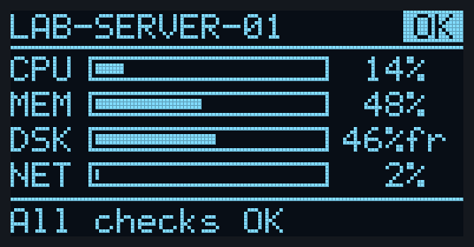
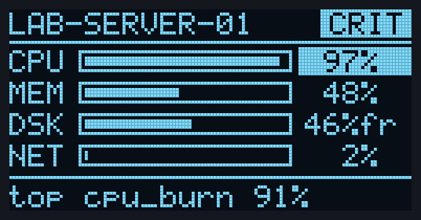
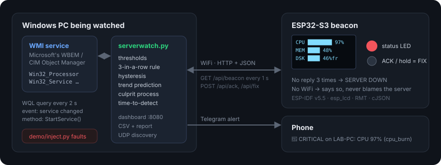

# ServerWatch

[](https://github.com/Harshit6-b/serverwatch/actions/workflows/ci.yml)

**Find out a Windows server is failing before your users do, using nothing but the
management interface that is already built into Windows (WMI / WBEM).**

A small Python agent reads CPU, memory, disk, network and service state over WMI, decides
when a reading is really a problem, and tells you which process is to blame. An ESP32-S3
"beacon" on your desk turns red, shows what broke, and has a button that restarts a crashed
service over WMI.

<p align="center">
  
  
  
</p>
<p align="center"><sub>The beacon's actual screen code, rendered on a PC (<code>firmware/tools/render_screens.c</code>).</sub></p>

**Quick try (Linux/macOS, no hardware):** `git clone https://github.com/Harshit6-b/serverwatch.git && cd serverwatch && ./start.sh`,
then open <http://localhost:8080>. Full instructions: [Setup on a new computer](#setup-on-a-new-computer).

## Why

"Does it answer ping?" misses most real failures. A server can reply to ping while its disk
is full, its memory is leaking or its web service has crashed. Windows already exposes all of
that through WMI, Microsoft's implementation of the DMTF's WBEM standard, so no agent has to be
installed on the server you watch.

## What it does

- **Reads** the five health signals every 2 s with plain WQL (`SELECT LoadPercentage FROM Win32_Processor`, …)
- **Decides** with warning/critical thresholds, an *N readings in a row* rule so a 3-second
  spike does not page anyone, and hysteresis so alerts don't flap
- **Reacts at once** to a stopped service (WMI event subscription) and to a server that stops answering
- **Explains**: names the process behind a CPU or memory problem, predicts *"disk critical in ~3 min"*
  from the trend, notices a silent reboot, and pulls past crash evidence from the event log
- **Measures itself**: the fault injector stamps the moment each fault starts, so every
  incident shows a real *time to detect*
- **Fixes**: hold the beacon's button and the agent calls `Win32_Service.StartService()`
- **Alerts** on the dashboard, on the beacon, and on your phone (Telegram)

## Results

Output of `demo/inject.py report` after one run of every fault in the **simulator**.
Real hardware numbers will go here after the lab run.

| Fault | Outcome | Time to detect |
|---|---|---|
| 3-second CPU spike | ignored (correct) | – |
| CPU overload | CRITICAL, culprit `cpu_burn` | 12.0 s |
| Memory leak (rising 1.2 %/s) | WARNING, culprit `leaky_app` | 26.0 s |
| Disk filling (2 %/s) | CRITICAL | 18.0 s |
| Service crash | CRITICAL | 0.0 s |
| Server unreachable | UNREACHABLE | 0.3 s |

6/6 faults handled correctly, 0 false alarms. Time to detect counts from the moment the
fault *started*. For a slow leak that includes the time the leak takes to cross the
threshold, so it is honest rather than flattering.

## How it works

<p align="center"></p>

| Step | WBEM concept | In ServerWatch |
|---|---|---|
| Read | `ExecQuery` (WQL) | five queries every poll, see `agent/sources.py` → `QUERIES` |
| Be told | Indication | `__InstanceModificationEvent WITHIN 2 … ISA 'Win32_Service'` |
| Act | `InvokeMethod` | `Win32_Service.StartService()` from the FIX button |
| Explain | – | `Win32_PerfFormattedData_PerfProc_Process`, `LastBootUpTime`, `Win32_NTLogEvent` |

Detection rules (`agent/engine.py`):

| Metric | Warning | Critical |
|---|---|---|
| CPU | ≥ 75 % | ≥ 90 % |
| Memory in use | ≥ 80 % | ≥ 92 % |
| Disk free | ≤ 15 % | ≤ 5 % |
| Network | ≥ 70 % of link | ≥ 90 % of link |
| Service | – | not Running |
| WMI session | – | fails → UNREACHABLE |

A metric escalates only after 3 readings in a row at that level, and clears only 5 points
back inside the limit. All of this can be changed live from the dashboard.

## Setup on a new computer

You need up to three things. Only the first is required.

| What | Runs on | Needs |
|---|---|---|
| **Agent** (reads WMI, dashboard, alerts) | the Windows PC you want to watch | Python 3.9+ |
| **Simulator** (try it without Windows) | any Linux or macOS computer | Python 3.9+, git |
| **Beacon** (desk device) | ESP32-S3 board, flashed from any Windows/Linux/macOS computer | ESP-IDF v5.5, USB cable |

Steps: [1. Agent on Windows](#1-agent-on-the-windows-pc) ·
[2. Simulator](#2-try-it-without-windows-simulator) ·
[3. Install ESP-IDF](#3-install-esp-idf-once-per-computer) ·
[4. Flash the beacon](#4-build-and-flash-the-beacon) ·
[5. Demo](#5-run-the-demo) ·
[Troubleshooting](#troubleshooting)

### 1. Agent on the Windows PC

**1.1 Install Python.** Download Python 3.9 or newer from
[python.org](https://www.python.org/downloads/). On the first installer screen tick
**"Add python.exe to PATH"**. (The `python` that Windows offers from the Microsoft Store is
only a shortcut; `start.ps1` detects it and asks you to install the real one.)

**1.2 Get the code.** On the repo page click **Code → Download ZIP** and extract it, or:

```powershell
git clone https://github.com/Harshit6-b/serverwatch.git
```

**1.3 Start it.** Open **PowerShell as Administrator** (Start menu → right-click
*Windows PowerShell* → *Run as administrator*), go to the folder and run:

```powershell
cd C:\path\to\serverwatch
Set-ExecutionPolicy -Scope Process Bypass      # allows the script, for this window only
.\start.ps1
```

The first run creates `.venv`, installs Flask and pywin32, and opens TCP port 8080 in the
Windows firewall. Then it prints something like:

```
ServerWatch agent (wmi) watching LAB-PC, services=['Spooler']
  dashboard:  http://192.168.43.20:8080/
  agent key (for FIX, put it in the beacon's menuconfig): 7fQx2LkA9bWe
  telegram alerts: off (set SW_TG_TOKEN and SW_TG_CHAT)
```

Write down the **dashboard address** and the **agent key**. The key is created once and kept
in `agent\.serverwatch-key`, so it stays the same next time.

**1.4 Open the dashboard** from the same PC (`http://localhost:8080`) or from any phone or
laptop on the same network (the address printed above).

**Options** (arguments replace the default `--services Spooler`, so include it):

| Want | Command |
|---|---|
| Watch more services | `.\start.ps1 --services Spooler,W32Time` |
| Choose your own key | `.\start.ps1 --services Spooler --key mysecret` |
| Different port | `.\start.ps1 --services Spooler --port 9000` (then open that port in the firewall) |
| Watch another PC | `.\start.ps1 --services Spooler --target LAB-PC --user LAB-PC\admin` (DCOM; that PC must allow the *Windows Management Instrumentation* firewall rules) |
| Phone alerts | see below |

**Telegram alerts (optional).** In Telegram, message **@BotFather**, send `/newbot` and copy
the token. Send your new bot any message, then open
`https://api.telegram.org/bot<TOKEN>/getUpdates` in a browser and copy the number after
`"chat":{"id":`. Start the agent with both set:

```powershell
$env:SW_TG_TOKEN="123456:ABC..."; $env:SW_TG_CHAT="987654321"; .\start.ps1
```

### 2. Try it without Windows (simulator)

On Linux or macOS with Python 3.9+ and git:

```bash
git clone https://github.com/Harshit6-b/serverwatch.git
cd serverwatch
./start.sh
```

Open <http://localhost:8080>. The yellow *SIMULATOR* bar creates failures. The beacon works
with the simulator too, which is handy for testing the hardware before you have a Windows PC.
On Debian/Ubuntu, if it says it cannot create a virtualenv: `sudo apt install python3-venv`.

### 3. Install ESP-IDF (once per computer)

The beacon firmware is built with Espressif's **ESP-IDF v5.5**. Install it on the computer
you will plug the board into. Pick your system:

<details open>
<summary><b>Windows</b></summary>

1. Download the **ESP-IDF Windows Installer** from <https://dl.espressif.com/dl/esp-idf/>.
2. Run it, choose version **v5.5**, keep the defaults. It installs Python, git, the compiler
   and the USB drivers.
3. When it finishes, open **"ESP-IDF 5.5 PowerShell"** from the Start menu. Use this window
   (not a normal PowerShell) for every `idf.py` command below.

</details>

<details>
<summary><b>Ubuntu / Debian</b></summary>

```bash
sudo apt-get update
sudo apt-get install git wget flex bison gperf python3 python3-pip python3-venv cmake \
    ninja-build ccache libffi-dev libssl-dev dfu-util libusb-1.0-0

mkdir -p ~/esp && cd ~/esp
git clone -b v5.5 --recursive https://github.com/espressif/esp-idf.git
cd esp-idf && ./install.sh esp32s3

# allow your user to open the USB serial port, then log out and back in once
sudo usermod -aG dialout $USER
```

In **every new terminal**, before using `idf.py`:

```bash
. ~/esp/esp-idf/export.sh
```

(Tip: add `alias get_idf='. ~/esp/esp-idf/export.sh'` to `~/.bashrc`, then just type `get_idf`.)

</details>

<details>
<summary><b>macOS</b></summary>

```bash
xcode-select --install                 # if you don't have the command line tools
brew install cmake ninja dfu-util python

mkdir -p ~/esp && cd ~/esp
git clone -b v5.5 --recursive https://github.com/espressif/esp-idf.git
cd esp-idf && ./install.sh esp32s3
```

In every new terminal: `. ~/esp/esp-idf/export.sh`

</details>

Check it worked: `idf.py --version` should print `ESP-IDF v5.5`.

Prefer an editor? The [ESP-IDF extension for VS Code](https://marketplace.visualstudio.com/items?itemName=espressif.esp-idf-extension)
installs the same thing through a setup wizard; choose v5.5.

### 4. Build and flash the beacon

**4.1 Pick your board.**

<details open>
<summary><b>A. SRA VJTI Wall-E 2026 board (no wiring)</b></summary>

The [Wall-E board](https://github.com/SRA-VJTI/sra-board-component) already has the OLED
(SDA 14 / SCL 21) and an 8×8 LED matrix (MAX7219), so you only need a USB cable. The matrix
shows big status icons you can read from across the room:

<p align="center"></p>

The board has no user buttons, so the **BOOT** button is used: short press = acknowledge,
hold 1.5 s = FIX.

```bash
cd serverwatch/firmware
idf.py -D SDKCONFIG_DEFAULTS="sdkconfig.defaults;sdkconfig.walle" set-target esp32s3
```

</details>

<details>
<summary><b>B. Any ESP32-S3 DevKit + a 0.96" OLED</b></summary>

| Part | Notes |
|---|---|
| ESP32-S3 dev board | DevKitC-1 or similar, with its onboard WS2812 RGB LED |
| 0.96" SSD1306 OLED, I2C | 128×64 |
| 1–2 push buttons | optional: the BOOT button works too |

| From | To |
|---|---|
| OLED VCC / GND | 3V3 / GND |
| OLED SDA / SCL | GPIO 8 / GPIO 9 |
| Button 1 | GPIO 4 ↔ GND (short = acknowledge, hold 1.5 s = FIX) |
| Button 2 | GPIO 5 ↔ GND (FIX), optional |

```bash
cd serverwatch/firmware
idf.py set-target esp32s3
```

Different pins? Change them in menuconfig under *DevKit pins*.

</details>

**4.2 Enter your settings.**

```bash
idf.py menuconfig
```

Open **ServerWatch Beacon** (arrow keys, Enter; `S` saves, `Q` quits) and set:

| Setting | What to enter |
|---|---|
| WiFi name (SSID, 2.4 GHz) | the network the Windows PC is on; the ESP32-S3 cannot join 5 GHz |
| WiFi password | its password |
| Agent key | the key `start.ps1` printed in step 1.3 (needed for FIX) |
| Agent IP address | leave empty: the beacon finds the agent by itself |
| Board | already set by step 4.1 |

These settings are saved in `firmware/sdkconfig`, which git ignores, so your password never
ends up in the repo.

**4.3 Plug in the board and flash.**

```bash
idf.py build flash monitor
```

If several boards are connected, or it cannot find the port, give it explicitly:
`-p COM5` on Windows (see Device Manager → Ports), `-p /dev/ttyACM0` or `/dev/ttyUSB0` on
Linux (`ls /dev/ttyACM* /dev/ttyUSB*`), `-p /dev/cu.usbmodem…` on macOS.

The monitor shows the beacon's log. A good start looks like:

```
ServerWatch Beacon on SRA Wall-E 2026: SSID 'MyHotspot', agent auto-discover, OLED ok
WiFi up, beacon IP 192.168.43.57
agent found at 192.168.43.20
state 0: All checks OK
```

Exit the monitor with **Ctrl+]**. The beacon keeps running without the computer; any USB
power supply will do.

**4.4 What the beacon shows.**

| DevKit LED | Wall-E matrix | Meaning |
|---|---|---|
| green | ✓ | all checks pass |
| amber | ! | warning |
| red, blinking | ✗ blinking | critical, not acknowledged (screen flashes too) |
| red, steady | ✗ steady | critical, acknowledged |
| magenta, blinking | sad face | server not answering |
| blue | WiFi icon | the beacon itself has no WiFi |
| cyan / spinner | dot running round the edge | looking for the agent |

All the OLED screens are in [`docs/img/beacon/`](docs/img/beacon/).

**Changing WiFi later** (a new hotspot, a different lab): run `idf.py menuconfig` again, change
the WiFi settings, then `idf.py build flash`.

### 5. Run the demo

`demo/inject.py` causes real failures on the watched PC and tells the agent when each one
starts, so every alert gets a measured *time to detect*. In a second **Administrator**
PowerShell in the serverwatch folder:

```powershell
.\demo\make_demo_disk.ps1        # once: a 1 GB virtual drive S: so the disk test never touches C:
python demo\inject.py tour       # spike, CPU, memory, disk, service crash + FIX, then the results table
```

Or one at a time: `inject.py spike | cpu 40 | mem 94 | disk S: 3 | service Spooler | report`.
Remove the demo drive afterwards with `.\demo\remove_demo_disk.ps1`.

The dashboard's **Report (.md)** and **Readings (.csv)** links export everything.

### Troubleshooting

| Problem | Fix |
|---|---|
| `running scripts is disabled on this system` | run `Set-ExecutionPolicy -Scope Process Bypass` in that window first |
| `Python not found` from `start.ps1` | install from python.org with *Add python.exe to PATH*, then open a new PowerShell |
| FIX says *access denied* | the agent must run in an **Administrator** PowerShell |
| FIX says *wrong key* | the beacon's agent key must match the one `start.ps1` printed (`agent\.serverwatch-key`) |
| Dashboard opens on the PC but not on the phone | same WiFi? `start.ps1` must have run as Administrator to add the firewall rule |
| Beacon stuck on **SEARCHING** | beacon and PC on different networks, or the network blocks broadcasts: put the PC's IP in *Agent IP address* in menuconfig |
| Beacon shows **NO WIFI** | wrong SSID/password, or the hotspot is 5 GHz only: switch it to 2.4 GHz |
| Beacon shows **SERVER DOWN** but the PC is fine | the agent isn't running, or port 8080 is blocked by the firewall |
| `idf.py: command not found` | run `. ~/esp/esp-idf/export.sh` (Linux/macOS) or use the *ESP-IDF 5.5 PowerShell* (Windows) |
| `Permission denied: '/dev/ttyACM0'` | `sudo usermod -aG dialout $USER`, then log out and back in |
| `Failed to connect to ESP32-S3` | hold **BOOT**, tap **RESET/EN**, release BOOT, then flash again |
| OLED stays blank | check the I2C address in menuconfig (0x3C, some modules 0x3D); the log says `no OLED answering` if it is not found |
| OLED or matrix upside down | menuconfig → *Rotate the OLED by 180 degrees* (tell us if the matrix is mirrored on your board revision) |
| No WMI data / `RPC server is unavailable` | the WMI service (*winmgmt*) is stopped, or for `--target` the remote PC's firewall blocks WMI |

## Project layout

```
agent/        serverwatch.py (agent + web API), engine.py (rules), sources.py (WMI + simulator),
              static/index.html (dashboard), test_engine.py
firmware/     ESP-IDF project for the beacon (main/; board.h has the pin maps), tools/ renders the screens on a PC
demo/         inject.py fault injector (standard library only), demo-disk scripts
start.sh      one-command start on Linux/macOS (simulator)
start.ps1     one-command start on Windows (real WMI)
docs/img/     diagram and beacon screens
```

Tests: `cd agent && python -m unittest test_engine`

## Limits and security

- Windows only for live data, because WMI is Windows' WBEM. On Linux the same model is available
  through OpenPegasus / SBLIM with `pywbem`; adding a source for it is a good next step.
- Polling every 2 s can miss shorter events, which is why services also use an event subscription.
- A powered-off remote target makes DCOM wait about 20 s before failing.
- The dashboard has no login. Run it on a trusted network. FIX and threshold changes need the agent
  key, FIX only touches services on the watch list, and every action is logged.
- Thresholds are starting points. Tune them per server.

## Background

Built as the practical part of a *Telecommunication Networks and Management* case study,
"How to detect a server failure using WBEM and WMI", at VJTI Mumbai.

## License

MIT, see [LICENSE](LICENSE).
